<p align="center">
  
</p>

  

MyLesson is a structured tour of the Android View system: **24 packages, 44 classes and 43 layouts**, each package covering one topic from a course — from the simplest button to ViewPager2 with fragments. It doubles as a personal reference: when I need to remember how a GridView adapter or a custom dialog is wired, the answer is in here.

## Features

- **Lists** — ListView with a custom adapter, `ListAdapter`, an **ExpandableListView**, GridView gallery
- **RecyclerView** with click listeners, a full-screen image viewer, and **pull-to-refresh** (`SwipeRefreshLayout`)
- **ViewPager2** with fragments and a custom adapter
- **Dialogs** — standard, list and custom-layout dialogs
- **Nine view animations**: alpha, rotate, scale, translate, fade-in, combined, and slide-in from three directions
- **Forms** — registration screen, add-user → user-info flow passing data between activities
- **Persistence** with SharedPreferences
- **Pickers & inputs** — DatePicker, TimePicker, Spinner, options menu, random-number generator, calculator
- Images loaded with **Glide**

## How it works

The project is organised by topic rather than by layer, so every package reads like a lesson:

```
animation/   calculator/   customdialog/  date/        dialoglist/   dialogs/
expandable/  fragments/    gridview/      layouts/     list/         listadapter/
menu/        randomnumber/ recyclerview/  registration/ sahifalar/   shared/
spinner/     time/         uielements/    user/        viewpager2/
```

Animations are defined declaratively in `res/anim/` and started with `AnimationUtils.loadAnimation`, which keeps the Kotlin side to a single line per effect.

## Project structure

```
com.example.mylesson
├── MainActivity.kt
├── animation/  (1)  AnimationActivity
├── calculator/  (1)  CalculatorActivity
├── customdialog/  (1)  DialogCustomMain
├── date/  (1)  DatePickerActivity
├── dialoglist/  (1)  DialogList
├── dialogs/  (1)  DialogMain
├── expandable/  (2)  CustomAdapter, MainActivity
├── fragments/  (3)  FirstFragment, FragmentActivity, SecondFragment
├── gridview/  (2)  GalleryAdapter, GridViewActivity
├── layouts/  (1)  FrameLayout
├── list/  (4)  CustomAdapter, FruitImageActivity, FruitModel, ListViewActivity
├── listadapter/  (2)  MainActivity, MyListAdapter
├── menu/  (1)  MenuActivity
├── randomnumber/  (1)  RandomNumberActivity
├── recyclerview/  (6)  GalleryActivity, GalleryAdapter, ImageViewActivity, MyCustomAdapter …
├── registration/  (1)  RegistrationActivity
├── sahifalar/  (2)  FirstActivity, SecondActivity
├── shared/  (1)  SharedActivity
├── spinner/  (1)  SpinnerActivity
├── time/  (1)  TimePickerActivity
├── uielements/  (1)  UIElementsActivity
├── user/  (2)  AddUserActivity, UserInfoActivity
└── viewpager2/  (4)  CustomDateModel, CustomViewPagerAdapter, SampleFragment, ViewPagerActivity
```

<sub>42 source files · 1,310 lines of code · 43 layouts</sub>

## Tech stack

| | |
|---|---|
| **Language** | Kotlin |
| **UI** | XML layouts, View Binding |
| **Min / Target SDK** | 24 / 34 |
| **Glide** | Image loading |
| **SwipeRefreshLayout** | Pull to refresh |

## Getting started

```bash
git clone https://github.com/rajabbov/MyLesson.git
```

1. Open the folder in **Android Studio** (Ladybug or newer).
2. Let Gradle sync.
3. Run the `app` configuration on a device or emulator.

## Known limitations

- Switch the launcher activity in `AndroidManifest.xml` to open a different lesson.

---

Made by **Ibrohimjon Rajabboyev** · [@rajabbov](https://github.com/rajabbov)
